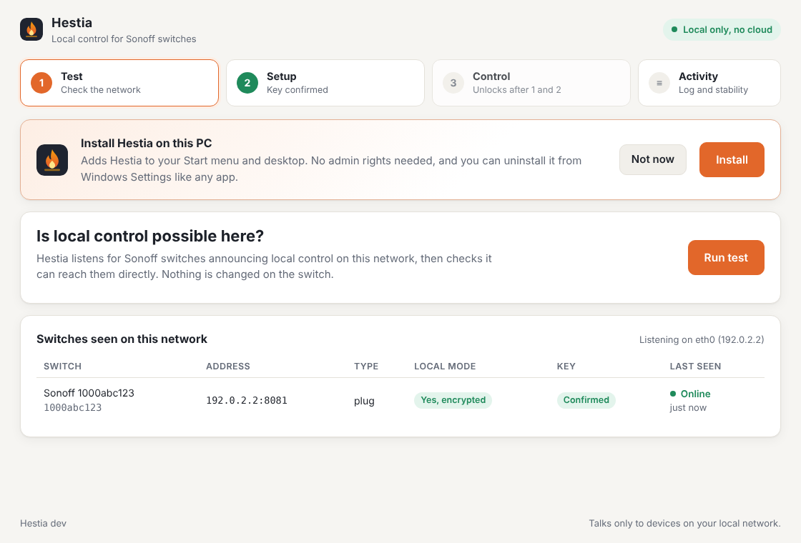
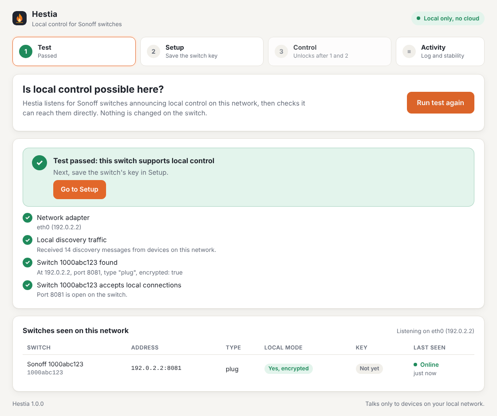
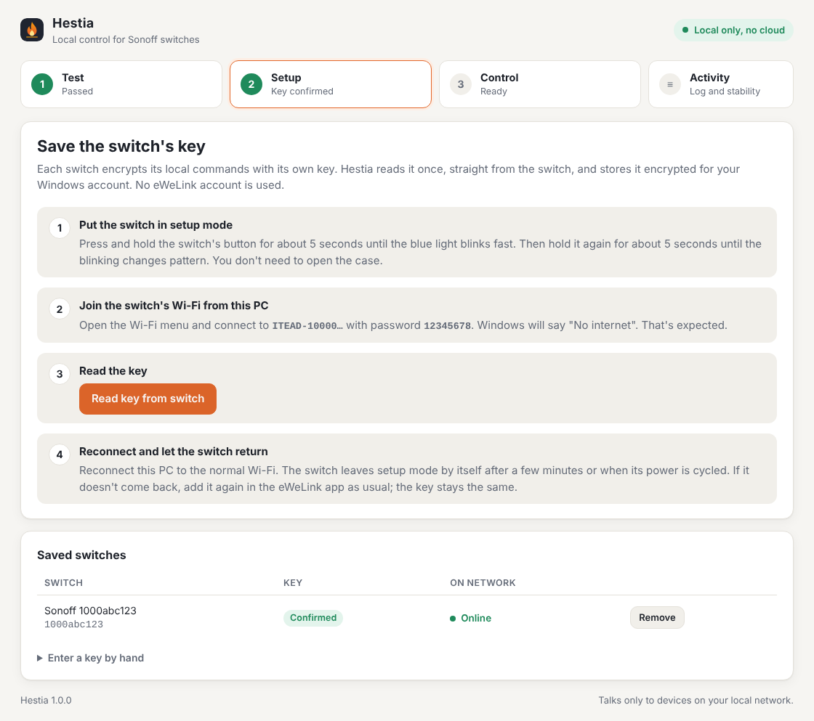
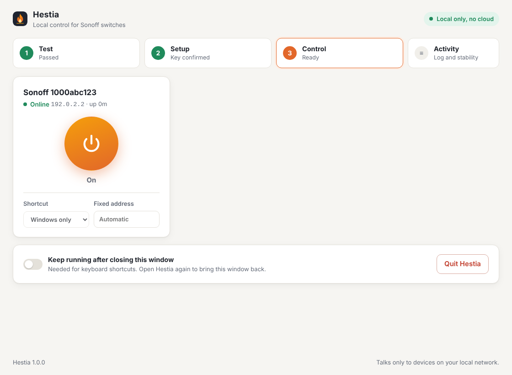
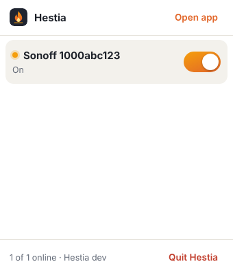

# Hestia: step-by-step guide

Hestia runs on your PC and talks only to devices on your local network. It never contacts eWeLink. The only internet call it makes is a daily check on GitHub for a new version, which you can turn off.

## 1. Install

1. Download **[Hestia-Setup.exe](https://github.com/djshiye/hestia-command/releases/latest/download/Hestia-Setup.exe)**.
2. Open it. If Windows says *"Windows protected your PC"*, click **More info**, then **Run anyway**. Hestia isn't code-signed, so Windows shows this once.
3. Click **Install** on the orange banner. Hestia is added to the Start menu and desktop and reopens from there. You can delete the downloaded file.
4. If Windows asks about the firewall, tick **Private networks** and click **Allow**.

## 2. Test: is local control possible here?

- Your PC must be on the **same network as the switch**. Wi-Fi or a network cable both work, but a guest network does not.
- Click **Run test**. It takes about 8 seconds.
- **Passed** means the switch accepts local control. Go on to Setup.
- **Not passed**: take a screenshot of the checks and send it over.

## 3. Setup: save the switch's key (needs Wi-Fi once)

1. Hold the switch's button for about 5 seconds until the blue light blinks fast. Then hold it again for about 5 seconds until the blinking changes.
2. On the PC, join the Wi-Fi named `ITEAD-10000…` with password `12345678`. Windows will say "No internet". That's expected.
3. Click **Read key from switch**. It says "Key saved" within a few seconds.
4. Reconnect the PC to the normal network. If the switch doesn't come back by itself within a few minutes, add it again in the eWeLink app as usual. The key stays the same.

The key is stored encrypted for your Windows user.

**Cable-only PC:** do steps 1 to 3 on a laptop with Wi-Fi, then click **Show key** under *Saved switches*. On the cable PC, open Setup, choose **Enter a key by hand** and paste the device ID and key.

## 4. Control

- This tab unlocks once the test has passed and a key is confirmed.
- Click the big round button to turn the switch on or off. You can rename a switch by clicking its name.
- **Shortcut:** pick a key combination such as Ctrl+Alt+1 to toggle the switch from anywhere.
- **Start with Windows** starts Hestia quietly in the tray after you sign in.
- **Quit Hestia** stops it completely. Open it again from the Start menu.

## Tray icon

Closing the window doesn't stop Hestia: it keeps running as a small flame icon by the clock (click the **^** arrow on the taskbar if Windows hides it; you can drag it out to keep it visible).

- **Click** the icon for a small popup with an on/off switch for each device. It closes by itself when you click elsewhere or press Esc.
- **Right-click** it for a menu: turn a switch on or off, **Open Hestia**, or **Quit Hestia**.
- **Hover** it to see each switch's state.

If you'd rather Hestia close together with its window, turn off **Stay in the tray when this window is closed** in the Control tab.

## 5. Activity and the 48-hour test

- The Activity tab shows every on/off command, drop-off and reconnection, with uptime per switch.
- After the cloud is blocked, leave Hestia running for 48 hours. Then click **Export log** and send the file over.

## Updates

Hestia keeps itself up to date. Once a day it asks GitHub whether there's a new version, checks the new version's signature, and installs it when you're not using the window. If the window is open, a green banner offers **Restart and update**; the restart takes a few seconds and your switches stay as they were.

- The switch **Update automatically** at the bottom of the window turns this off. **Check now** checks on the spot.
- This daily check is the only time Hestia ever uses the internet, and it only talks to GitHub.

## Uninstall

Go to Windows Settings → Apps → Installed apps → **Hestia** → **Uninstall**. It asks whether to also delete your saved switches and keys.

## Where Hestia keeps things

- Program: `%LocalAppData%\Programs\Hestia`
- Settings, encrypted keys and log: `%AppData%\Hestia`. The log never contains keys.
